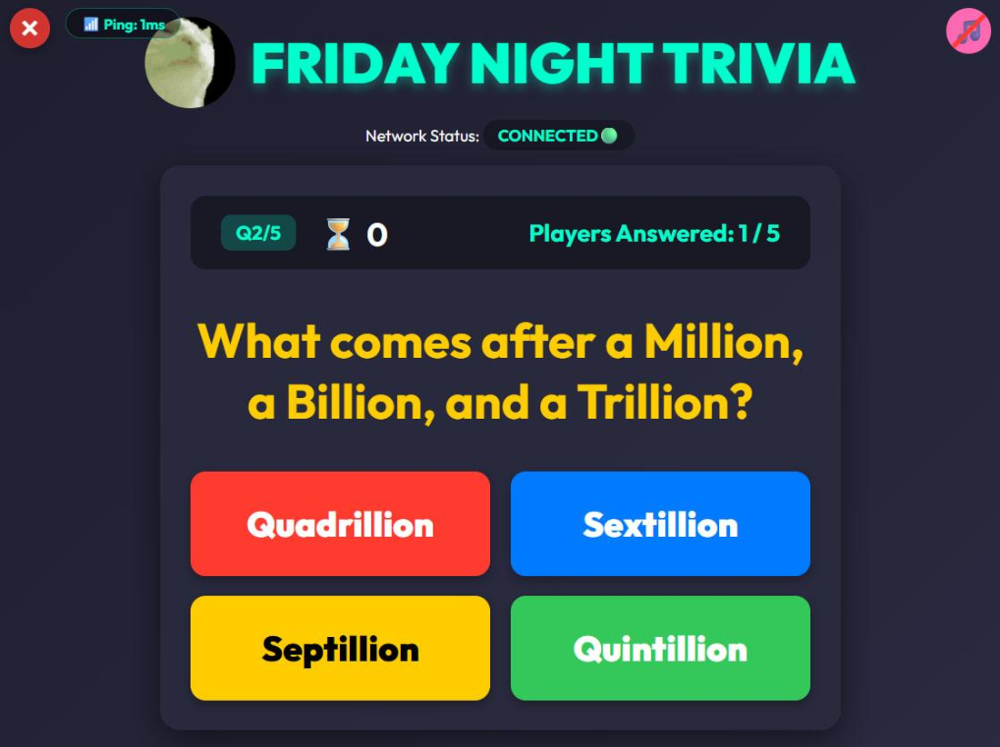
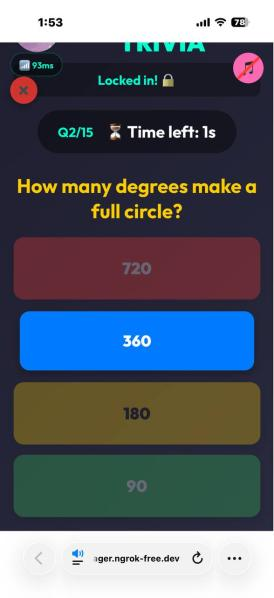
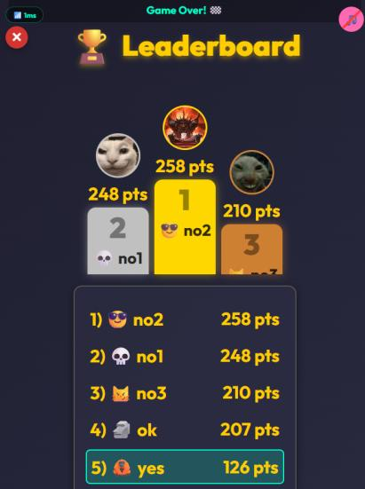

# Multiplayer Trivia Game Server

A real-time multiplayer quiz game I built for KP35203 Network Programming at Universiti Malaysia Sabah (2026, individual project). The host runs the game on a laptop and players join from their phones, even on mobile data.



<p>
  
  
</p>

## Features

- **WebSockets instead of polling:** each player keeps one full-duplex connection, and the server pushes questions, countdowns and leaderboards to everyone at the same moment
- **Asynchronous server:** FastAPI and asyncio handle many players without blocking the game loop
- **Join from anywhere:** an Ngrok reverse-proxy tunnel and a QR code let players on cellular data get past NAT and firewalls
- **Heartbeat and latency:** an application-layer heartbeat every 20 seconds keeps proxied connections alive and shows each player's round-trip time
- **Speed-based scoring** with a live leaderboard after every question
- Questions from the Open Trivia Database by category, or custom questions written by the host

## Tech stack

Python, FastAPI, Uvicorn, WebSockets, asyncio, httpx, HTML, CSS, JavaScript, Ngrok

## Run it

```bash
pip install -r requirements.txt
python server.py        # host dashboard at http://localhost:8000
ngrok http 8000         # in a second terminal, so phones can join from anywhere
```

Players scan the QR code on the host screen (or open the Ngrok link), type a name and pick an avatar.

Sound files are not included. Add your own `correct.mp3`, `wrong.mp3`, `tick.mp3`, `bgm.mp3` and `host.mp3` to `sounds/`.

## Files

| File | Purpose |
|---|---|
| `server.py` | FastAPI app: WebSocket endpoints, game state, timers, scoring, heartbeat |
| `host.html` | Host dashboard: game settings, lobby, questions, leaderboard |
| `player.html` | Mobile player interface |

## Author

Desmond Ong Kye Xiang
